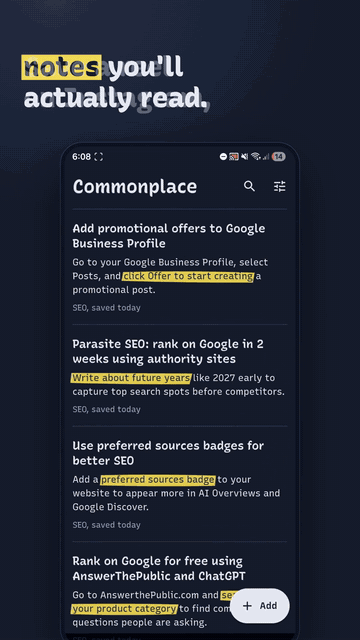
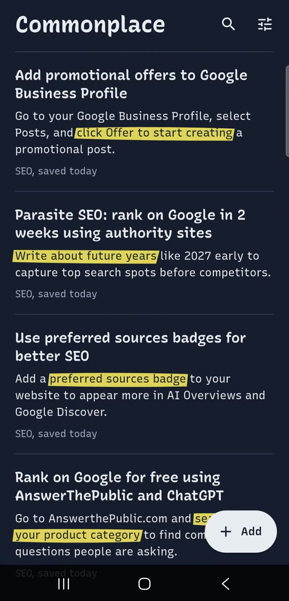
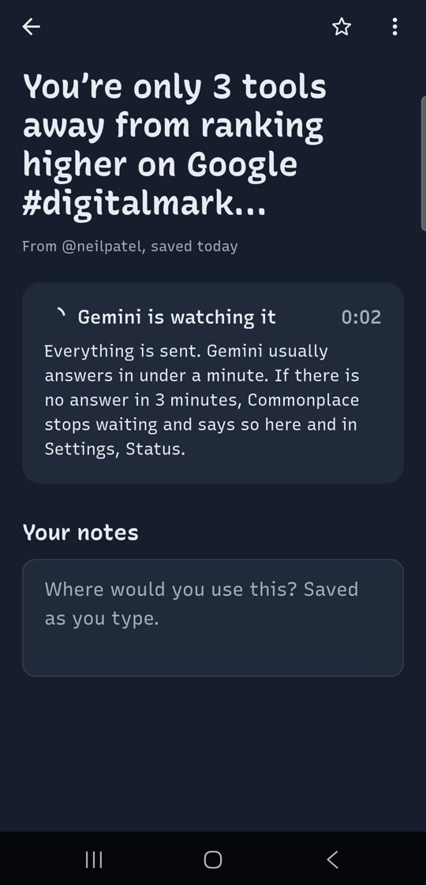
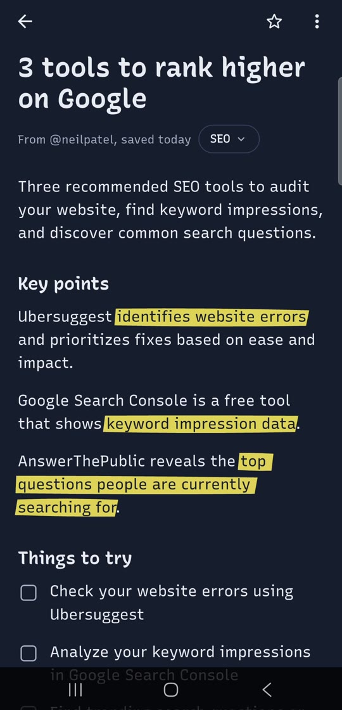
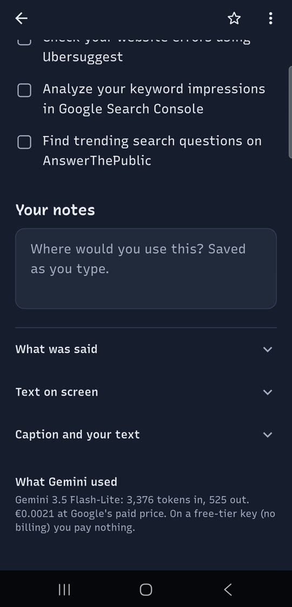

<div align="center">

<a href="https://itsaulgoodman.github.io/commonplace/#demo"></a>

<sub><a href="https://itsaulgoodman.github.io/commonplace/#demo">Watch the full video with sound (47 s)</a></sub>

# Commonplace: turn saved Instagram reels into AI notes

**A free, open-source Android app.** Save a reel on Instagram and get a note you'll actually read: the key points, things to try, and everything that was said. It runs on your own free Google Gemini API key.

<a href="https://github.com/ItSaulGoodMan/commonplace/releases/latest/download/Commonplace.apk"></a>

<sub>Won't install? <a href="https://github.com/ItSaulGoodMan/commonplace/releases/latest/download/Commonplace-all-phones.apk">Get the version for all phones (63 MB)</a></sub>

[**Watch the demo**](https://itsaulgoodman.github.io/commonplace/#demo) &nbsp;&nbsp; [**Website**](https://itsaulgoodman.github.io/commonplace/)

[](https://github.com/ItSaulGoodMan/commonplace/releases/latest)
[](LICENSE)


</div>

## Why

You hear something useful on Instagram, tap save, and tell yourself you'll watch it later. Later never comes, and the Saved tab turns into a pile of reels you'll never scroll through again.

Commonplace makes the note the moment you save, so what you saved is there when you need it. It's named after the commonplace book: the notebook people kept for copying down whatever was worth keeping.

## What you get

- **Notes from your saves, automatically.** Connect Instagram once. Every reel you save becomes a note the next time you open the app.
- **Or share any reel.** In Instagram, tap Share, then Commonplace. Reels, posts and carousels all work.
- **Notes you can skim.** A plain title, a short summary, key points with the important phrase highlighted, and a checklist of things to try.
- **Everything that was said.** The transcript, the text on screen and the caption stay with the note, and search finds them.
- **Topic shelves.** Notes sort themselves into topics. Move one with a tap if the AI got it wrong.
- **One older note a day.** The home screen brings back something you saved before, so saves don't disappear.
- **The exact cost under every note.** Tokens in and out, and the price in euros. On a free key it's nothing.
- **Small uploads.** Videos are made smaller on the phone before they're sent, and deleted once the note is made.
- **No account, no server.** Notes live in a database on your phone. The app talks only to Google (for the note) and Instagram (for your saves).

<table>
  <tr>
    <td></td>
    <td></td>
    <td></td>
    <td></td>
  </tr>
  <tr>
    <td align="center">Your saves, as notes</td>
    <td align="center">Gemini watches the reel</td>
    <td align="center">Key points and things to try</td>
    <td align="center">The exact cost, in euros</td>
  </tr>
</table>

## Get started

1. **Download the app.** On your phone, tap the yellow **Download for Android** button at the top of this page. When the download finishes, open `Commonplace.apk` and tap **Install**. The first time, Android asks to allow your browser to install apps: tap **Settings**, turn on **Allow from this source**, go back and tap **Install**. If Android says the app isn't compatible, download [the version for all phones](https://github.com/ItSaulGoodMan/commonplace/releases/latest/download/Commonplace-all-phones.apk) instead.
2. **Get a free Gemini API key.** Go to [aistudio.google.com/apikey](https://aistudio.google.com/apikey), sign in with your Google account and tap **Create API key**. Don't turn on billing: without it the key stays on the free tier, and nothing can be charged.
3. **Paste the key into Commonplace**, then tap **Connect Instagram** to turn your saves into notes. Or skip that and share reels to the app one by one.

## Is it really free?

Yes. The app is free and MIT-licensed. Google's free Gemini tier needs no card, and its daily limit is plenty for a few reels a day. If the limit runs out, notes wait and say so; nothing is charged.

If you ever do turn on billing, a note costs a fraction of a cent: the reel in the demo cost €0.0021 with Gemini Flash-Lite. The app shows the exact amount under every note and a monthly total in Settings.

One thing to know: on the free tier, Google may use what you send to improve its products. Don't send anything private.

## Questions

**Does it need my Instagram password?**
No. You sign in on Instagram's own page inside the app. Commonplace keeps only the session, encrypted on the phone and left out of backups. Signing in is optional: sharing works without it.

**Is reading my Saved list allowed?**
Instagram has no official API for saved posts, so Commonplace reads them the way instagram.com does, with your own sign-in. It reads only your own saves, only while the app is open, and stops at any security check instead of working around it. Instagram's terms don't allow automated access, so if that ever stops working, sharing a downloaded video still does. Details under [How the Instagram sign-in works](#how-the-instagram-sign-in-works).

**Is there an iPhone version?**
Not yet. The app is built in Flutter and almost all of it is shared; what iOS still needs is listed under [iOS](#ios).

**Can the notes be in my language?**
Yes. Pick the note language in Settings, and any note can be written again in another language without sending the video again.

**Why Gemini?**
It watches the video and hears the sound in one request, reads text on screen, and has a free tier.

---

*The rest of this page is for developers.*

Android first, built in Flutter. The code is platform-neutral; iOS needs the extra steps listed under [iOS](#ios).

## Two editions

One codebase builds two apps (Android product flavors, `lib/config.dart`):

| | **personal** (`--flavor personal`) | **play** (`--flavor play`) |
|---|---|---|
| For | You, from [GitHub Releases](https://github.com/ItSaulGoodMan/commonplace/releases/latest) | Everyone, on Google Play (not published yet) |
| App | "My Commonplace", `com.nemanjapejic.commonplace.personal` | "Commonplace", `com.nemanjapejic.commonplace` |
| Instagram | Sign in with Instagram, saves become notes | Share the downloaded video |
| AI | Your own free Gemini key, called from the phone | Sign in with Google; the Commonplace server ([server/](server/)) makes notes on a shared free key |
| Limits | Gemini's free limit for your key | 3 notes a day free, 25 with Commonplace Plus (Google Play subscription) |

Publishing the play edition, step by step: [docs/PUBLISHING.md](docs/PUBLISHING.md).

The rest of this README describes the personal edition.

## Using it

1. **Connect Instagram.** On the welcome screen (or in Settings), tap **Connect Instagram** and sign in on Instagram's own page. Choose whether your 10 latest saves become notes too, or only new ones.
2. **Save reels as usual.** Tap the bookmark on any reel or post in Instagram. The next time you open Commonplace, it looks at your Saved list, fetches what's new, and makes the notes. Pull down on the home screen to look right away.
3. **Or share one.** In Instagram, tap **Share**, then **Commonplace**. When you're signed in, the link is enough; Commonplace fetches the reel itself.
4. **Read the note.** It's ready in under a minute. Tick off the things you try, add your own thoughts under *Your notes*, and move it to another shelf if the AI got the topic wrong.

Without signing in, everything still works the old way: share the link, then **Share → Download** in Instagram and share that video too (or pick it with **Add → Choose a video**). Screen recordings, screenshots of carousels and plain text (**Add → Write or paste text**) work either way.

### How the Instagram sign-in works

Instagram has no official API for saved posts, so Commonplace reads your Saved list the way instagram.com does, with your own sign-in:

- You sign in on Instagram's real page inside the app. Commonplace never sees your password; it keeps only the session cookie, encrypted in the Android Keystore and left out of backups.
- It reads only your Saved list and the posts you share with it, only while the app is open, and at most every two minutes (one small request when nothing is new).
- If Instagram asks you to sign in again or confirm it's you, Commonplace stops and sends you to Instagram's page. It never tries to get around a check.

These are undocumented endpoints, so Instagram can change them at any time, and automated access isn't something its terms allow. If it stops working, sharing a downloaded video still does. Details and sources are in [docs/RESEARCH.md](docs/RESEARCH.md).

## The Gemini key (free)

Commonplace needs a Google Gemini API key. **Create it at [aistudio.google.com/apikey](https://aistudio.google.com/apikey) and don't enable billing.** Without billing, the key stays on the free tier: no card, and a daily limit that's plenty for a few reels a day. If the limit runs out, notes say so and wait. Nothing gets charged.

On the free tier Google may use what you send to improve its products. The key is stored in the Android Keystore and never leaves the phone except in requests to Google.

Two models are offered in Settings: **Gemini Flash** (`gemini-flash-latest`, best notes) and **Flash-Lite** (`gemini-flash-lite-latest`, more free headroom). Both use Google's "latest" aliases, so the app keeps working as models are retired.

## Building

Requirements: Flutter 3.47+, Android SDK with platform 37, NDK 28.2 (for the bundled SQLite), JDK 17+. The server needs Node 22+.

```bash
flutter pub get
dart run build_runner build                      # regenerates the Drift database code
flutter test --timeout 60s                       # no network, real in-memory SQLite
flutter run --flavor personal                    # every Android command needs a flavor
flutter build apk --release --flavor personal    # for sideloading
cd server && npm install && npm test             # server tests, in the Workers runtime
```

Release builds are signed with the key named in `android/key.properties` (never committed), or with the debug key when there is none. See [docs/PUBLISHING.md](docs/PUBLISHING.md).

### Testing without a key, an Instagram account, or spending anything

Two local stand-ins answer the same endpoints the app uses, check that requests have the right shape, and send nothing anywhere:

- `tool/mock_gemini_server.py` (port 8787) returns realistic canned notes.
- `tool/mock_instagram_server.py` (port 8788) serves a sign-in page, a Saved list with three posts, post lookups and a fake CDN.

```bash
python tool/mock_gemini_server.py
python tool/mock_instagram_server.py
flutter run --flavor personal \
            --dart-define=GEMINI_BASE_URL=http://10.0.2.2:8787 \
            --dart-define=INSTAGRAM_BASE_URL=http://10.0.2.2:8788   # emulator; debug builds only
```

The play edition against the local server instead (made-up Google sign-in and Play purchases, debug builds only):

```bash
python tool/mock_gemini_server.py
cd server && npm run migrate:local && npm run dev                   # :8790
flutter run --flavor play --dart-define=API_BASE_URL=http://10.0.2.2:8790 --dart-define=DEV_FAKES=true
```

In the app, sign in with any username and password, and enter any Gemini key starting with `AQ.` (or the older `AIza`). A key containing `RATELIMIT` makes the Gemini mock answer 429. To act as yourself on Instagram:

```bash
curl "localhost:8788/mock/save?caption=Pasta%20tip"   # save a new reel, then pull to refresh
curl localhost:8788/mock/signout                      # Instagram ends the session
```

Release builds ignore both `--dart-define`s and always talk to Google and Instagram.

## How it's built

The structure follows the official Flutter architecture guidance: MVVM with `ChangeNotifier` view models, repositories over services, and constructor injection through `provider`.

```
lib/
  data/
    services/      gemini_client.dart (REST: generateContent + Files API),
                   instagram_api.dart (Saved list, post lookup, CDN download),
                   web_cookies.dart (the sign-in web view's cookies),
                   database/ (Drift/SQLite), local_stores.dart (key, prefs, media),
                   share_inbox.dart (Android share sheet)
    repositories/  notes_repository.dart, settings_repository.dart,
                   instagram_repository.dart (sign-in, seen posts, fetching)
  domain/
    models/note.dart, prompts.dart, shared_link.dart, revisit.dart
    use_cases/     capture.dart (anything shared → a note),
                   saved_sync.dart (new saves on Instagram → notes),
                   note_processor.dart (the queue: fetch → extract → distill)
  ui/
    core/          theme.dart (tokens, Recursive type), widgets/highlighted_text.dart
    features/      home, note, add, instagram (sign-in), settings, welcome
```

**The pipeline.** For a post from Instagram, the processor first looks it up and downloads its video or images (a carousel's first ten items). Then the note is made in **one** Gemini request: the video (inline up to 14 MB, Files API above that) goes in once, and a JSON schema asks for both what was read (transcript, on-screen text, visual notes) and the note. One request instead of two halves what a note costs against Gemini's free daily request limit. Thinking is kept low, since Google bills it as output.

What was read is stored, so **Write the note again** (or switching the note language) is a cheap text-only request that doesn't upload the video again.

**The queue** lives in the database. Notes interrupted by the app closing go back in the queue on the next start. A dropped connection is tried once more after a few seconds, and notes that still failed that way are retried the next time the app opens. A Gemini rate limit pauses the queue for two minutes, an Instagram "please wait" for ten. Without a key, notes simply wait, and nothing is downloaded. Videos are deleted after the note is made, unless you turn on *Keep videos* in Settings.

**Design** is described in [docs/DESIGN.md](docs/DESIGN.md): cool paper, blue-black ink, one fluorescent highlighter, and the Recursive typeface in two voices.

## iOS

Not built yet; it needs a Mac. Everything in `lib/` is shared. What's missing:

- A Share Extension target for `receive_sharing_intent` ([plugin docs](https://pub.dev/packages/receive_sharing_intent)).
- `NSPhotoLibraryUsageDescription` in `ios/Runner/Info.plist` for the video picker.
- The Instagram sign-in reads cookies through a small Android-only channel (`commonplace/web_cookies` in `MainActivity.kt`). iOS needs the same two methods backed by `WKHTTPCookieStore`.

## Ideas for later

- A daily notification with the revisit note.
- Checking the Saved list in the background (WorkManager), so notes are ready before you open the app.
- Picking which Saved collection to follow instead of "All posts".
- Bringing in older saves a page at a time.
- Export of everything to Markdown or Obsidian.

## License

MIT, see [LICENSE](LICENSE). The Recursive typeface is under the SIL Open Font License ([assets/fonts/OFL.txt](assets/fonts/OFL.txt)).
